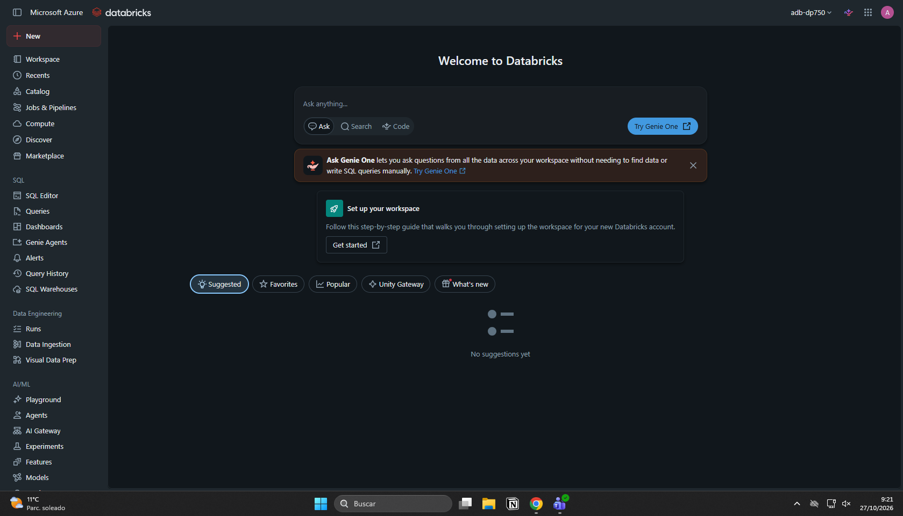
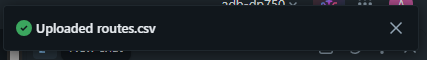
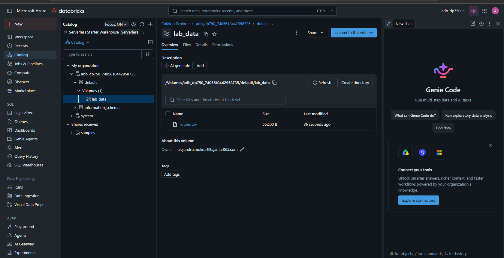
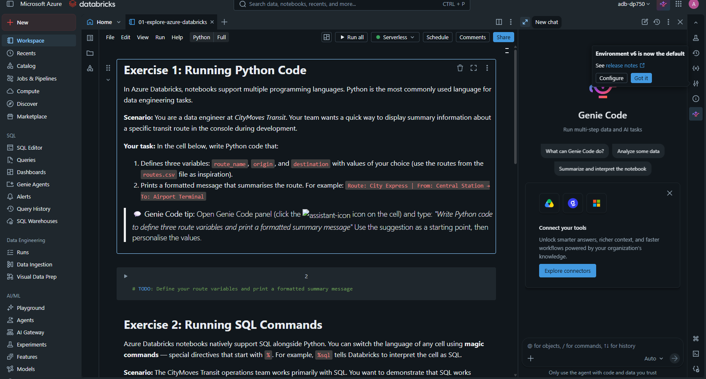

# Laboratorio 01: Explorar Azure Databricks

En este laboratorio, darás tus primeros pasos con Azure Databricks en el contexto de CityMoves Transit, una autoridad regional de transporte público que gestiona servicios de autobús, tranvía y tren a través de un área metropolitana. Como ingeniero de datos recién incorporado, tu objetivo es familiarizarte con el área de trabajo de Azure Databricks antes de sumergirte en las canalizaciones de datos y la analítica en laboratorios posteriores.

Al final de este laboratorio, habrás:

* Navegado por las áreas clave de la interfaz de usuario (UI) del área de trabajo de Azure Databricks.
* Subido un conjunto de datos de muestra utilizando la interfaz de ingesta de datos.
* Explorado las características de los notebooks (cuadernos), incluyendo celdas de código Python, comandos mágicos de SQL y documentación en Markdown.

Este laboratorio debería tomar aproximadamente **45 minutos** en completarse.

## Requisitos previos

Antes de comenzar este laboratorio, asegúrate de tener:

* Un área de trabajo de Azure Databricks Premium aprovisionada (siguiendo el *Laboratorio 00: Configurar tu entorno de Azure Databricks*).
* Familiaridad con la navegación básica por el portal de Azure.
* No se requiere experiencia previa con Databricks.

## Ejercicio 1: Navegar por la interfaz del área de trabajo de Azure Databricks

Antes de escribir cualquier código, vamos a explorar el entorno de Azure Databricks. Sentirte cómodo con la interfaz de usuario te ayudará a trabajar de manera más eficiente a lo largo de este curso.

### Tarea 1: Explorar la barra lateral del área de trabajo

En tu área de trabajo de Azure Databricks, mira la barra lateral izquierda. Identifica las siguientes secciones:

* **Workspace (Área de trabajo)** — tus carpetas personales y compartidas para notebooks y archivos.
* **Recents (Recientes)** — objetos abiertos recientemente.
* **Catalog (Catálogo)** — tus activos de datos en Unity Catalog (tablas, volúmenes, esquemas).
* **Jobs & Pipelines (Trabajos y Canalizaciones)** — flujos de trabajo automatizados.
* **Compute (Proceso)** — gestión de clústeres y almacenes SQL.
* **Marketplace** — datos y soluciones de socios.

1. Haz clic en **+ New (Nuevo)** (en la parte superior de la barra lateral) y revisa los tipos de objetos que puedes crear (notebooks, consultas, clústeres, paneles, etc.). No crees nada todavía; esto es solo para exploración.
2. Usa la barra de **Search (Búsqueda)** en la parte superior para buscar `routes`. No aparecerá nada todavía, pero usarás esto más adelante para localizar activos de datos después de la ingesta.

### Tarea 2: Explorar Genie Code

Genie Code es un programador de pares impulsado por IA integrado directamente en Azure Databricks. Puede generar código, explicar errores, sugerir mejoras y responder preguntas — todo sin salir de la interfaz de usuario. Se espera y se anima a que lo utilices a lo largo de este laboratorio y en todos los laboratorios futuros.

1. Desde la página de inicio de Azure Databricks, haz clic en el icono de **Genie Code** en la esquina superior derecha de la página para abrir el panel de Genie Code.
2. Escribe el siguiente *prompt* y observa la respuesta:

   ```
   What can I do with Azure Databricks as a data engineer?
   ```

3. Revisa la respuesta. Nota cómo Genie Code proporciona orientación contextual adaptada a tu área de trabajo.

> 💡 **Consejo:** A partir de este momento, siempre que se te pida escribir código o SQL, utiliza Genie Code. Describe lo que deseas en lenguaje natural, y luego adapta y ejecuta la sugerencia.

### Tarea 3: Subir un conjunto de datos de transporte de muestra

CityMoves Transit ha proporcionado un archivo CSV con información de rutas. Tu tarea es subirlo al área de trabajo usando la interfaz de ingesta de datos para que esté disponible para laboratorios posteriores.

Antes de subirlo, necesitas un **volumen de Unity Catalog** para almacenar el archivo. Sigue estos pasos para crear uno:

1. En la barra lateral del área de trabajo de Databricks, haz clic en **Catalog (Catálogo)**.
2. En el Explorador de Catálogos (Catalog Explorer), expande el catálogo `adb-dp750`, luego expande el esquema `default`.
3. Haz clic en el menú **⋮** junto a `default`, luego selecciona **Create > Volume (Crear > Volumen)**.
4. Escribe `lab_data` como el nombre del volumen, deja el tipo como *Managed* (Administrado) y haz clic en **Create (Crear)**.

Ahora sube el archivo de datos:

5. En la barra lateral, haz clic en **+ New (Nuevo)**, luego selecciona **Add or upload data (Agregar o subir datos)**.
6. En la interfaz de subida de datos, selecciona **Upload files (Subir archivos)**.
7. Descarga el archivo desde la siguiente URL, luego haz clic en **Browse (Examinar)** para seleccionarlo: `https://raw.githubusercontent.com/MicrosoftLearning/DP-750T00-Implement-Data-Engineering-Solutions-using-Azure-Databricks/refs/heads/main/Allfiles/data/routes.csv`
8. Cuando se te pida un destino, selecciona el volumen que acabas de crear: `adb-dp750 > default > lab_data`.
9. Una vez completada la subida, navega a **Catalog** en la barra lateral izquierda y localiza el archivo subido. Expande la jerarquía del catálogo (`adb-dp750 > default > lab_data`) para verificar que `routes.csv` está visible.

> **Nota:** No necesitas consultar ni cargar los datos en este laboratorio. El objetivo es simplemente familiarizarse con el flujo de subida. Trabajarás con estos datos en laboratorios posteriores.

## Importar el notebook del laboratorio

Ahora que el archivo de datos está subido, importa el notebook del laboratorio a tu área de trabajo de Databricks.

1. En tu área de trabajo de Azure Databricks, haz clic en **Workspace (Área de trabajo)** en la barra lateral izquierda.
2. Navega o crea una carpeta donde desees almacenar el laboratorio (por ejemplo, `Labs/01-explore-azure-databricks`).
3. Haz clic en el menú **⋮ (kebab)** junto a la carpeta, o haz clic derecho sobre ella, y selecciona **Import (Importar)**.
4. Elige **URL**, introduce la siguiente URL y haz clic en **Import (Importar)**: `https://raw.githubusercontent.com/MicrosoftLearning/DP-750T00-Implement-Data-Engineering-Solutions-using-Azure-Databricks/refs/heads/main/Allfiles/01-explore-azure-databricks.ipynb`
5. Abre el notebook importado. En el selector de proceso (compute) en la parte superior del notebook, elige **Serverless compute (Proceso sin servidor)**.

## Continuar en el notebook

Has completado los ejercicios basados en la interfaz de usuario. Ahora abre el notebook importado `01-explore-azure-databricks.ipynb` y continúa con los ejercicios prácticos de codificación directamente allí.

> **Importante:** Asegúrate de que **Serverless compute** esté seleccionado antes de ejecutar cualquier celda.